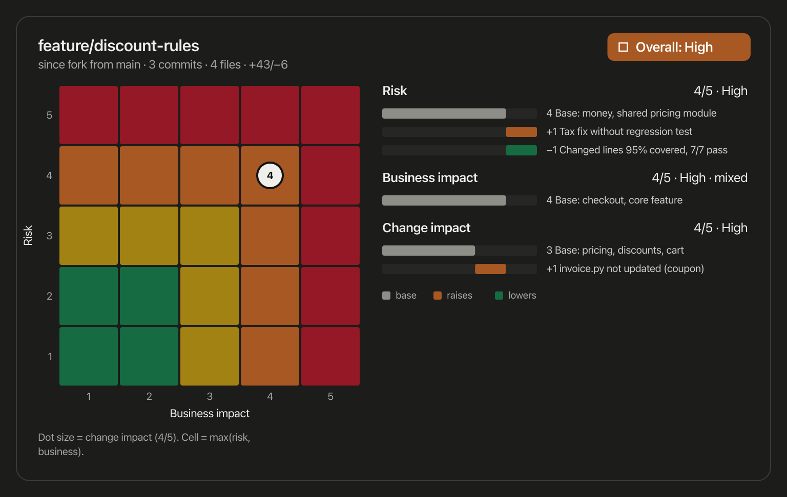

# risk-impact

[](LICENSE)

An [Agent Skill](https://docs.claude.com/en/docs/claude-code/skills) that assesses the **risk** and the **impact** (business impact and change impact) of a code change, so you know what a change can break and who it affects before it goes into a PR or merge.

## What it does

- Reads the diff: either **everything on the feature branch since it was forked** (default) or **only the last commit** (when asked, or when invoked on the base branch).
- **Runs the project's tests** and reads **code coverage**. Failing tests raise the risk; high coverage of the *changed lines* lowers it. Code that many tests use (a heavily used method or class) is core code, so changing it raises the risk.
- Rates three dimensions from 1 to 5, each with a stated base level plus modifiers and evidence from the code (files, symbols, callers, test results):
  - **Risk:** likelihood and severity of failure. Refactoring counts as a risk, not as a free pass.
  - **Business impact:** how people work with the tool (UI, workflows, API consumers), core features, performance (better or worse), compliance, data.
  - **Change impact:** affected modules, interfaces, data, performance, deployment and operations (found by tracing callers and consumers, not just reading the diff).
- Takes the **WHY** of the change into account (from you, commits, branch name, tickets; asks if unknown): it shapes the business impact, and a diff that does not match its stated purpose, or an unknown purpose, raises the risk.
- Presents the result as a **graphic** (SVG, optional PNG): a risk / business-impact matrix with change impact as dot size, bars that show the base level and what raises or lowers each rating, the overall level as a badge, faded dots for earlier runs on the same branch, and for large diffs a hotspot panel (test fan-in vs. changed-line coverage per file). It is drawn by a script from the same numbers as the report, so runs are comparable and image and text cannot disagree.
- Derives an overall level (Low / Medium / High / Critical) and concrete recommendations: tests to add, review focus, rollout and rollback.
- Asks when the code cannot answer (data volume, consumers, deployment), and marks ratings `provisional` meanwhile.
- Should run **before a PR or merge**, but can be invoked at any time.



Example: [report](examples/feature-discount-rules.md), [input JSON](examples/feature-discount-rules.json), [graphic (SVG)](examples/feature-discount-rules.svg). It comes from real runs of the helpers on a small fictional shop project, where the skill finds that the invoice ignores a coupon the cart applied.

## Install

```bash
npx skills add tobiashofmann/risk-impact
```

Only the `skills/risk-impact/` folder (`SKILL.md`, `collect_diff.py`, `test_signals.py` and `render_graphic.py`) is installed; tests stay in the repo.

Or copy `skills/risk-impact` to `~/.claude/skills/risk-impact` (personal) or `<project>/.claude/skills/risk-impact` (per project).

## Requirements

- git
- Python 3 (standard library only) for the helpers.
- Optional, for PNG output: `pip install cairosvg` or `rsvg-convert`. The SVG needs nothing.
- For test results: whatever the project's own tests need. Auto-detected: pytest, unittest, npm (jest/vitest), go, cargo, maven, gradle, rspec, dotnet.
- For coverage (optional): `pytest-cov` or `coverage` (Python), jest/vitest coverage (lcov), `go test -coverprofile`; or an existing lcov / Cobertura / coverage.py JSON report. Without coverage data the skill says so and judges test depth from the test files.

## Usage

Ask the agent, e.g. "assess the risk and impact of this branch before I open the PR", or invoke the skill explicitly (`/risk-impact` in Claude Code). Say "last commit" to limit the scope to `HEAD`.

The helper that collects the facts can also be run directly (in an installed skill it sits next to `SKILL.md`):

```bash
python3 skills/risk-impact/collect_diff.py                     # branch since fork point, else last commit
python3 skills/risk-impact/collect_diff.py --last-commit
python3 skills/risk-impact/collect_diff.py --base origin/main
python3 skills/risk-impact/collect_diff.py --working-tree      # include uncommitted changes
python3 skills/risk-impact/collect_diff.py --format json --patch
```

```bash
python3 skills/risk-impact/test_signals.py                      # run tests, coverage of changed lines, test fan-in
python3 skills/risk-impact/test_signals.py --no-run             # analyse only, do not execute tests
python3 skills/risk-impact/test_signals.py --cmd "make test" --timeout 900
```

```bash
python3 skills/risk-impact/render_graphic.py docs/risk-impact/feature-x.json --png            # draw the graphic
python3 skills/risk-impact/render_graphic.py report.json --palette vivid                      # muted (default) | vivid | classic
python3 skills/risk-impact/render_graphic.py new.json --prev old.json                         # add the earlier run as a faded dot
```

The JSON format is described in `SKILL.md` and in the header of `render_graphic.py`.

**Colors:** the level colors (Low, Medium, High, Critical) come from a preset: `muted` (default, Irish green to Portugal red, toned down), `vivid` (full strength) or `classic` (dark tints). Pick one with `--palette` or `"palette"` in the JSON, and override single colors with `"colors"`, for example:

```json
{ "palette": "vivid", "colors": { "Critical": "#C8102E", "Low": "#009A49" } }
```

Allowed keys: `Low`, `Medium`, `High`, `Critical`, `raises`, `lowers`, `base`, `track`; values must be `#RRGGBB`. Text on a colored cell switches between white and dark automatically.

`test_signals.py` **executes the project's tests**, which means running repository code. Use `--no-run` if you don't want that.

`collect_diff.py` lists the commits and files with line counts, classifies each file (source, test, migration, dependency, config, infra, CI/CD, API contract, docs, …) and flags mechanical risk signals such as migrations, security-sensitive paths, dependency changes or source changes without tests. The judgement itself is done by the agent.

## Tests

```bash
python3 -m unittest discover -s tests -v
```

## License

[Apache License 2.0](LICENSE)
