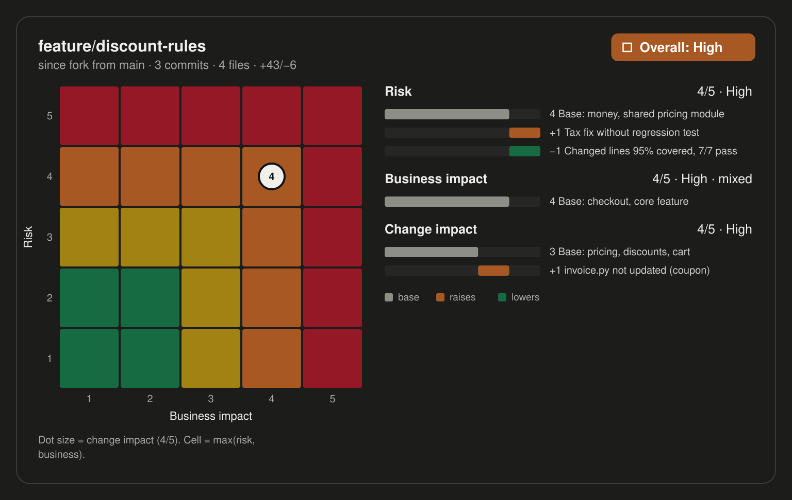

# Risk & impact: feature/discount-rules

> **Sample output.** This is what the `risk-impact` skill produces. The project is a small fictional shop checkout (`shop/pricing.py`, `shop/cart.py`, `shop/invoice.py`) with a feature branch that adds discount rules. The numbers come from real runs of `collect_diff.py` and `test_signals.py` on that project; the graphic is drawn by `render_graphic.py` from [`feature-discount-rules.json`](feature-discount-rules.json).

**Scope:** `feature/discount-rules` since fork from `main` · 3 commits · 4 files · +43/−6 lines
**Overall: High**   Risk 4/5 · Business impact 4/5 · Change impact 4/5

## Why this change
Add bulk and coupon discounts to the checkout, and fix tax rounding for invoices. Source: branch name and commit messages (Assumption, not confirmed by the developer). The diff matches it: discounts, their use in `order_total` and `Cart`, and the rounding fix named in a commit message.

## Summary
The branch adds discount rules and applies them in the shared price calculation `order_total`, which feeds the cart and the invoice. Tests pass and the changed lines are well covered, but `invoice.py` still calls `order_total` without the coupon, so an invoice will not match what the cart charged.

## Tests and coverage
- Result: unittest with coverage (`coverage run -m unittest discover -s tests`): 7 passed, 0 failed, 0 errors.
- Changed-line coverage: `discounts.py` 11/11 (100%), `pricing.py` 7/7 (100%), `cart.py` 3/4 (75%). Together 21 of 22 changed executable lines (95%). Uncovered: `cart.py:13` (`Cart.apply_coupon`).
- Central code touched: `order_total` is used by 2 test files and 2 other files (`cart.py`, `invoice.py`). That is below the threshold for "core by test usage" (3 test files), but it is the single price calculation of the shop, so it counts as core by role.
- Effect on risk: coverage −1, but the money path keeps its base level (no reduction below 4).

## Risk – 4/5
- Base 4: money. `shop/pricing.py` is the shared price calculation used by cart and invoice.
- +1: bug fix without regression test. `apply_tax` now rounds with `+ 1e-9`; no test covers the case it fixes, and the change alters invoice cents for every order. The `1e-9` offset is a workaround, not half-up rounding; `Decimal` with `ROUND_HALF_UP` would state the intent.
- −1: changed lines 95% covered and all tests pass.
- The invoice defect below is rated under change impact, not counted twice here.
- Refactoring: none; all changes add or alter behavior.

## Business impact – 4/5 (mixed)
- Human interaction: customers can enter a coupon code (new `Cart.apply_coupon`) and get a 10% bulk discount from 10 units, capped at 30%. Prices they see in the cart change.
- Core feature touched: yes. The checkout price calculation (`order_total`) is the core of the shop. Base 4.
- Mixed direction: the discounts are a gain for customers; the invoice mismatch (below) is a loss for customers and finance.
- Performance: none identified. The added work per order line is two dictionary lookups.

## Change impact – 4/5
- Affected but not changed: `shop/invoice.py` calls `order_total(items)` without a coupon. Reproduced on the branch: a cart with 2 × 100 and coupon `SAVE20` totals **190.40**, `invoice_amount` returns **238.00**.
- Also: the bulk discount now applies to invoices without any coupon (10 or more units), a behavior change on invoices that is not mentioned in any commit.
- Deployment / data: no migration, no new config keys. Rollback is a plain revert.

## Recommendations before merging
1. Pass the coupon to the invoice (`invoice_amount(items, coupon)`), and add a test that the cart total equals the invoice amount for a coupon order.
2. Add a regression test for the `apply_tax` rounding case, replace `+ 1e-9` with `Decimal` and `ROUND_HALF_UP`, and confirm with finance that the new cents are what they expect on invoices.
3. Decide whether bulk discounts should appear on invoices without a coupon; if yes, add a test, if not, move the discount out of `net_price`.
4. Add a test for `Cart.apply_coupon` (uncovered line `cart.py:13`).

## Not assessed / open questions
- The WHY is inferred from branch name and commits. Please confirm: is the tax rounding fix meant to ship with the discounts?
- Orders per day and share of orders with 10 or more units were not available, so the size of the financial exposure is not estimated.
